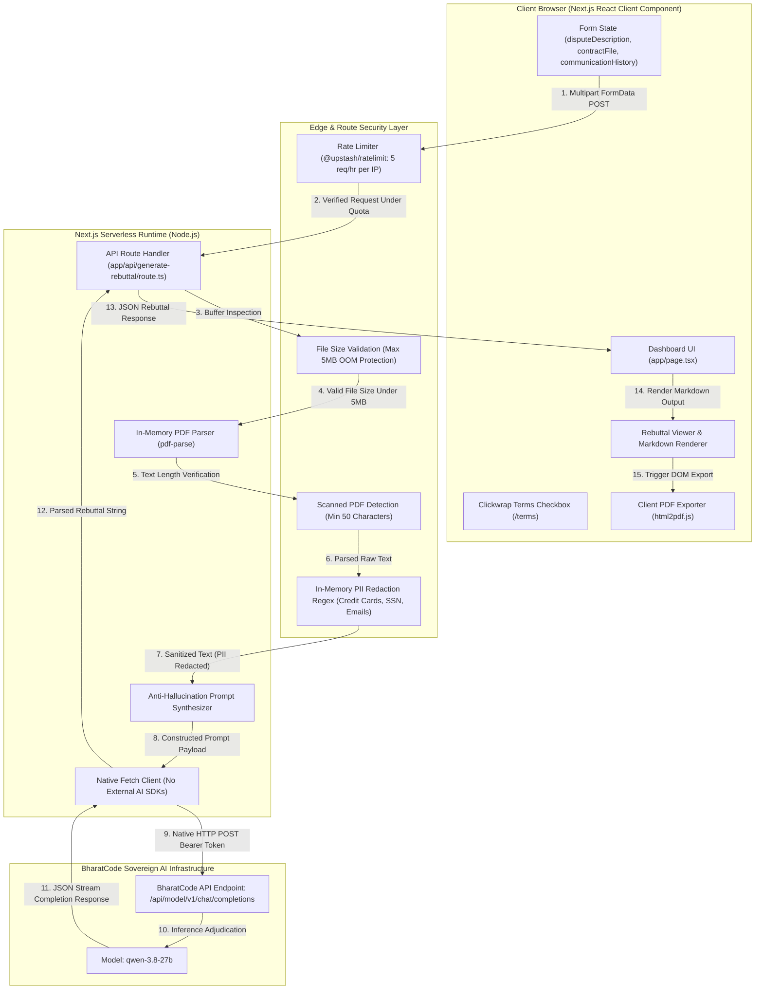

# System Architecture & Technical Specification
## Project Name: Nyaya (न्याय AI)
### Subtitle: Automated Chargeback Defense & Scope Creep Dispute Shield
**Hackathon Submission:** BharatCode Build League (Deadline: November 10, 2026)  
**Primary Engine:** BharatCode LLM Gateway (`qwen-3.8-27b`)  

---

## 1. High-Level System Architecture

Nyaya is architected as a modern, high-throughput, serverless web application using the Next.js App Router. It bridges client-side rich interaction, server-side document parsing, and sovereign LLM inference without any intermediate persistent data retention, ensuring total client data sovereignty.



---

## 2. Technology Stack Breakdown

| Layer | Technology | Version / Specification | Rationale & Responsibility |
|---|---|---|---|
| **Framework** | Next.js (App Router) | 14.x (Node.js runtime) | Hybrid rendering, optimized bundle, serverless route handlers. |
| **Language** | TypeScript | 5.x | Strict type safety for dispute payloads, API contracts, and form states. |
| **Styling** | Tailwind CSS & PostCSS | 3.4.x | Responsive, frosted glassmorphism dark aesthetic (`bg-slate-950`) with zero runtime CSS overhead. |
| **Icons** | Lucide React | 0.453.x | Clean, consistent FinTech iconography (`Scale`, `Shield`, `Zap`, `FileText`, `CheckCircle2`, `Download`). |
| **Rate Limiting** | `@upstash/ratelimit` & `@upstash/redis` | 2.x / 1.x | Strict sliding window rate limiting (5 requests/hour per IP with `'anonymous'` fallback). |
| **PDF Extraction** | `pdf-parse` | 1.1.x | Server-side binary buffer parsing to extract raw text from executed client contracts/SOWs in memory. |
| **PII Redaction** | In-Memory Regex Scrubber | Custom Zero-Retention | Masks Credit Cards (13-16 digits), SSNs (`XXX-XX-XXXX`), and Email addresses before AI prompt injection. |
| **Client PDF Export** | `html2pdf.js` | 0.10.x | Direct DOM-to-canvas-to-PDF compilation on the client without round-tripping to a server. |
| **AI Inference** | BharatCode Model API | Native HTTP `fetch` | Direct integration with `https://bharatcode.ai/api/model/v1/chat/completions` using sovereign `qwen-3.8-27b`. |

---

## 3. End-to-End Data Flow Sequence

The interaction follows an unyielding 8-phase evidentiary lifecycle:

### Phase 1: Client Ingestion & Clickwrap Consent (`app/page.tsx`)
- The user provides three data inputs:
  1. `disputeDescription`: String detailing the dispute reason (e.g., Stripe Reason: "Service Not as Described"), disputed amount, invoice ID, and buyer claims.
  2. `contractFile`: Binary `.pdf` file of the executed contract or Statement of Work (SOW).
  3. `communicationHistory`: Multiline string containing email logs, Slack exports, or message threads showing client sign-offs and timestamps.
- **Mandatory Clickwrap:** The user must explicitly check the disclaimer checkbox confirming Nyaya is an administrative formatting utility, not a law firm, agreeing to the [Terms of Service](/terms).
- The client encapsulates these into standard browser `FormData` and sends a `POST` request to `/api/generate-rebuttal`.

### Phase 2: Rate Limiting & OOM Protection (`app/api/generate-rebuttal/route.ts`)
- **Rate Limiting:** The route extracts the client IP from `x-forwarded-for` (falling back to `'anonymous'`). It queries Upstash Redis using a 5 requests/hour sliding window limiter. Exceeded quotas immediately return HTTP `429 Too Many Requests`.
- **File Size Validation (OOM Protection):** The server inspects both `contractFile.size` and the converted `Buffer.length`. If the file exceeds 5MB (`5 * 1024 * 1024`), the route immediately throws an error and returns `{ success: false, error: "File exceeds 5MB limit." }` with HTTP `400`.

### Phase 3: Ephemeral PDF Buffer Extraction & Scanned Document Check
- The `contractFile` is read as an ephemeral Node.js `Buffer`.
- `pdf-parse` extracts raw textual content from the PDF buffer in memory.
- **Scanned PDF Protection:** If `extractedText.trim().length < 50`, the route flags the document as an unreadable scanned image and returns HTTP `400` ("No readable text found. Please ensure your PDF is a text document, not a scanned image.").

### Phase 4: In-Memory PII Redaction Regex Step
- Before any data is injected into LLM prompt templates, extracted contract text, dispute descriptions, and communication logs pass through `sanitizePII()`:
  - **Social Security Numbers:** `\b\d{3}[ -]?\d{2}[ -]?\d{4}\b` &rarr; `[REDACTED_PII]`
  - **Credit Card Numbers:** `\b(?:\d[ -]?){13,16}\b` &rarr; `[REDACTED_PII]`
  - **Standard Email Formats:** `\b[A-Za-z0-9._%+-]+@[A-Za-z0-9.-]+\.[A-Za-z]{2,}\b` &rarr; `[REDACTED_PII]`
- Redacted strings ensure zero transmission of raw customer financial credentials or private PII across network boundaries.

### Phase 5: Anti-Hallucination Legal Prompt Synthesizer
- The prompt synthesizer injects the sanitized data into a rigorous five-section legal arbitration template:
  1. `EXECUTIVE SUMMARY`
  2. `CONTRACTUAL PROVISIONS` (Direct quotes only)
  3. `TIMELINE OF ACCEPTANCE` (Direct quotes only)
  4. `REBUTTAL OF ALLEGATIONS`
  5. `CONCLUSION & DEMAND FOR DISMISSAL`
- Strict system-level constraints enforce a **Verbatim Citation Mandate**, a **Zero-Inference Rule** ("No explicit written approval found in provided logs"), and a bolded `**MISSING DOCUMENTATION WARNING:**` if delivery proof is lacking for "Service Not Rendered" claims.

### Phase 6: BharatCode Native Fetch Call
- The server initiates an asynchronous HTTP `fetch` request to `https://bharatcode.ai/api/model/v1/chat/completions`.
- **Constraint Strictness:** No OpenAI, LangChain, or Anthropic client libraries are used. Only native Node.js global `fetch` is executed.
- Headers include `Authorization: Bearer ${process.env.BHARATCODE_API_KEY}` and `Content-Type: application/json`.
- The request specifies sovereign model `model: "qwen-3.8-27b"`.

### Phase 7: Response Validation & Client Hydration
- The server checks response `res.ok`. If successful, parses the JSON payload and extracts `data.choices[0].message.content`.
- The server returns `{ success: true, rebuttal: data.choices[0].message.content, evidentiaryReadiness: score }`.
- If an upstream error occurs, it catches the exception and returns a structured `{ success: false, error: "..." }` payload.

### Phase 8: Client Display, Markdown Rendering, & PDF Export
- The client replaces the initial Evidentiary Readiness status cards with the scrollable Rebuttal Output Pane:
  - **Formal Dossier Tab:** Formatted typography, Evidence Anchor Map tables, and blockquotes.
  - **Gateway Text Tab:** Monospace text area with character counter ready for Stripe/PayPal dispute forms.
  - **Defense Matrix Tab:** Interactive contractual defense audit.
  - **Export to PDF:** Triggers client-side `html2pdf.js` to compile an official A4 dispute dossier with certified letterhead.

---

## 4. Exact BharatCode API Payload Specification

### Endpoint:
```http
POST https://bharatcode.ai/api/model/v1/chat/completions
```

### HTTP Headers:
```http
Content-Type: application/json
Authorization: Bearer <BHARATCODE_API_KEY>
```

### Request JSON Payload:
```json
{
  "model": "qwen-3.8-27b",
  "messages": [
    {
      "role": "system",
      "content": "You are Nyaya AI, an administrative dispute formatting assistant. Do not refer to yourself as an attorney, lawyer, or legal counsel. Your mission is to help merchants format evidence against chargebacks.\n\nCRITICAL CONSTRAINTS (ANTI-HALLUCINATION & EVIDENCE INTEGRITY):\n1. VERBATIM CITATION MANDATE: Every claim of client approval or deliverable submission MUST directly quote a timestamped line from the provided COMMUNICATION LOGS. You are strictly forbidden from paraphrasing.\n2. ZERO-INFERENCE RULE: Under no circumstances may you invent or hallucinate client approvals. If logs lack explicit written sign-off, you must state exactly: \"No explicit written approval found in provided logs.\"\n3. MISSING EVIDENCE WARNING: If the Dispute Reason involves \"Service Not Rendered\" and no hard proof of delivery is found, you MUST explicitly flag this by generating a bolded \"**MISSING DOCUMENTATION WARNING:**\" at the top of the dossier.\n\nStructure the rebuttal into five sections:\n1. EXECUTIVE SUMMARY\n2. CONTRACTUAL PROVISIONS (Direct quotes only)\n3. TIMELINE OF ACCEPTANCE (Direct quotes only)\n4. REBUTTAL OF ALLEGATIONS\n5. CONCLUSION & DEMAND FOR DISMISSAL"
    },
    {
      "role": "user",
      "content": "Please synthesize an unassailable Dispute Rebuttal Dossier using the following authenticated project records:\n\n========================================\n1. DISPUTE CLAIM & TRANSACTION METADATA\n========================================\n[Sanitized claim details & transaction reference]\n\n========================================\n2. EXTRACTED CONTRACT / STATEMENT OF WORK (SOW)\n========================================\n[Sanitized text parsed from PDF contract with PII redacted]\n\n========================================\n3. COMMUNICATION LOGS & MILESTONE AUDIT TRAIL\n========================================\n[Sanitized communication transcript with emails, SSNs, and credit cards masked]"
    }
  ],
  "temperature": 0.2,
  "max_tokens": 3000
}
```

---

## 5. Security & Privacy Guarantees

1. **Zero Internal Data Retention:** Neither uploaded contracts nor chat histories are written to any disk, cache, or internal database.
2. **5MB File Size OOM Protection:** Ephemeral buffers are capped at 5MB prior to parsing to prevent serverless memory exhaustion.
3. **Sliding Window Rate Limiting:** 5 requests/hour per IP enforced via `@upstash/ratelimit` (falling back to `'anonymous'`).
4. **In-Memory PII Regex Sanitization:** Credit card numbers (13-16 digits), SSNs, and email addresses are automatically redacted to `[REDACTED_PII]` in memory before LLM inference.
5. **Environment Security:** `BHARATCODE_API_KEY` and Upstash credentials are loaded strictly on the server runtime via `process.env`, never exposed to the client bundle.
6. **Third-Party Processing Boundary:** While Nyaya AI operates a strict internal Zero Data Retention policy (processing files as ephemeral Node.js buffers), extracted contract text and communication logs are transmitted securely via HTTP POST to the external BharatCode Gateway for LLM inference. Users must review BharatCode's platform policies regarding prompt logging before uploading agreements.
