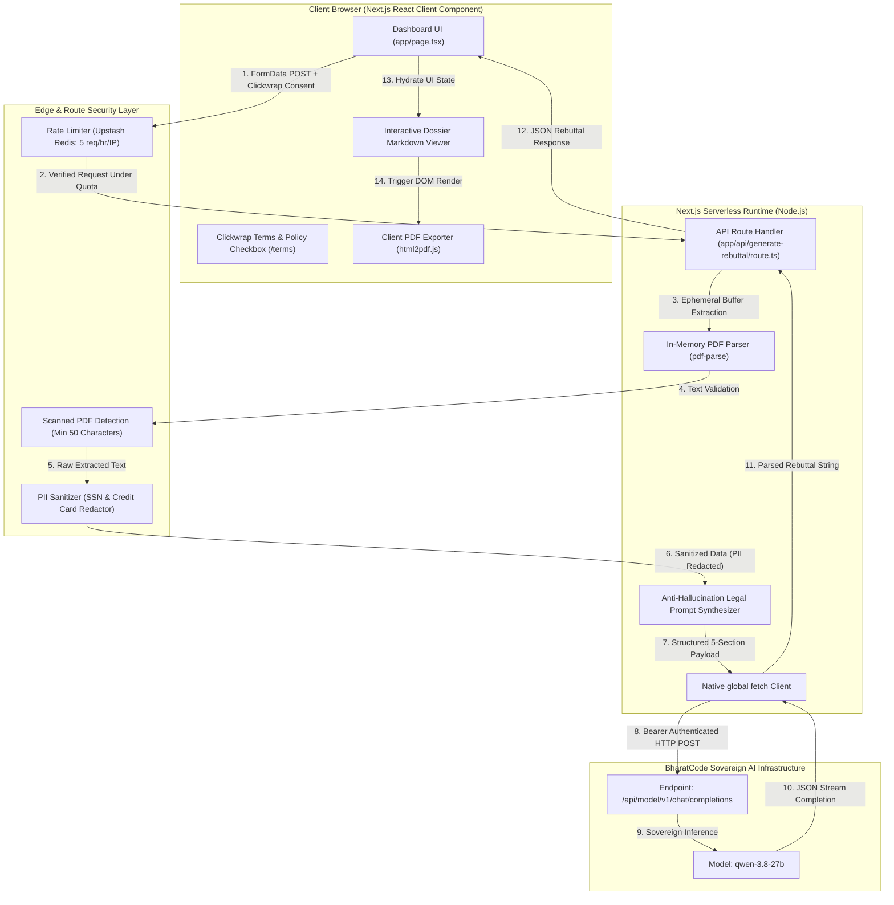

# ⚖️ Nyaya (न्याय AI) — Autonomous Dispute Shield for Creators & Merchants

> **The Sovereign Evidentiary Defense Engine for the Global Independent Economy.**  
> Built for the **BharatCode Build League Hackathon** (Deadline: November 10, 2026).  
> Powered by the **BharatCode Sovereign LLM Gateway** (`qwen-3.8-27b`).

---

[](https://bharatcode.ai)
[](https://bharatcode.ai)
[](https://nextjs.org/)
[](https://www.typescriptlang.org/)
[](https://tailwindcss.com/)
[](LICENSE)

---

## 📽️ Interactive Live Demo & Experience

```
+-----------------------------------------------------------------------------------+
|                                                                                   |
|                   [ ⚡ NYAYA AI INTERACTIVE DISPUTE SHIELD ]                      |
|                                                                                   |
|   1. Ingest Contract PDF  ──> In-Memory Buffer Extraction (Zero Storage)          |
|   2. Paste Chat Threads   ──> PII Sanitization (SSN & Credit Card Redaction)      |
|   3. Select Gateway       ──> Visa, Mastercard, Stripe, PayPal, Razorpay          |
|   4. Sovereign Inference  ──> BharatCode Gateway (qwen-3.8-27b Anti-Hallucination)|
|   5. One-Click Dossier    ──> Bank-Grade PDF Export & Clipboard Copy              |
|                                                                                   |
+-----------------------------------------------------------------------------------+
```

### Quick Demo Walkthrough:
1. Launch the local development server.
2. Click **"⚡ Load Sample Dispute"** to test a pre-configured Stripe scope creep dispute.
3. Review the dynamically generated **Evidence Anchor Map** and **Five-Pillar Dossier**.
4. Inspect the official [Terms of Service & Privacy Policy](/terms) page.

---

## 💥 The Problem: The $110B Unfair Chargeback Epidemic

Every year, independent software engineers, agencies, and digital merchants lose billions of dollars to **fraudulent chargebacks**, **"friendly fraud"**, and **scope creep extortion**:

1. **The Asymmetric System:** When a buyer issues a chargeback via Stripe, PayPal, or merchant acquirers, merchant funds are frozen immediately alongside a punitive $15–$25 dispute fee.
2. **The 180-Second Review Window:** Payment gateway dispute analysts evaluate hundreds of disputes daily, spending only **90 to 180 seconds** per submission. Chaotic screenshots or unstructured complaints result in automatic buyer favors.
3. **The Weaponization of Scope Creep:** Clients routinely sign off on deliverables, demand unbilled revisions outside the Statement of Work, and initiate chargebacks when boundaries are enforced.
4. **Administrative Barrier:** Most independent workers lack the hours and formal evidentiary skills required to format bank-grade dispute rebuttal packets within strict gateway deadlines.

---

## 🛡️ The Solution: Nyaya (न्याय AI)

**Nyaya** (*Sanskrit for Justice, Logic, and Rectitude*) is an **administrative dispute formatting assistant** that synthesizes raw contract clauses and informal communication transcripts into structured evidentiary submissions formatted directly for payment gateway dispute analysts:

- 📄 **Ephemeral Contract Ingestion:** Ingests executed Statements of Work (SOWs) and agreements via serverless `pdf-parse`. Files are processed strictly in transient memory.
- 💬 **Timeline & Acceptance Cross-Check:** Chronologically anchors client sign-offs, staging previews, and milestone approvals from communication channels (Slack, WhatsApp, Email).
- 🗺️ **Evidence Anchor Map:** Directly binds contractual clauses to timestamped chat approvals in a structured 3-column verification matrix.
- 🧠 **Sovereign Intelligence (`qwen-3.8-27b`):** Powered by direct native `fetch` to BharatCode's LLM Gateway (`https://bharatcode.ai/api/model/v1/chat/completions`) with zero third-party AI SDK overhead.
- 🔒 **Comprehensive Security Layer:** Includes Upstash Redis rate limiting, automatic PII redaction (SSN & Credit Card masking), scanned PDF detection, and clickwrap UPL safeguards.
- 📥 **One-Click Client PDF Export:** Synthesizes an official dispute letter via client-side `html2pdf.js`, ready for immediate portal upload.

---

## 🏗️ Technical Architecture & Evidentiary Data Flow



---

## 🏛️ The Five-Pillar Dossier Standard

Nyaya synthesizes disputes into a standardized five-section administrative dossier designed for fast review by bank analysts:

| Section | Title | Primary Responsibility |
|---|---|---|
| **I** | **EXECUTIVE SUMMARY** | Transaction ID, disputed amount, merchant stance, and refutation of gateway reason code. |
| **II** | **CONTRACTUAL PROVISIONS** | Direct verbatim quotes of signed clauses, milestone rules, and change-order covenants. |
| **III** | **TIMELINE OF ACCEPTANCE** | Direct quotes and timestamped approvals demonstrating milestone sign-offs. |
| **IV** | **REBUTTAL OF ALLEGATIONS** | Point-by-point refutation of buyer allegations using contractual facts and recorded logs. |
| **V** | **CONCLUSION & DEMAND FOR DISMISSAL** | Formal closing statement demanding chargeback reversal and dispute fee rescission. |

---

## 🔐 Advanced Security, Privacy & Liability Safeguards

### 1. Zero Data Retention & Memory Isolation
- No contract files or message histories are ever stored on disk, persistent caches, or databases.
- Files are parsed directly from streaming Node.js `Buffer` objects in volatile memory and discarded upon garbage collection.

### 2. Automatic PII Redaction (`sanitizePII`)
- Built-in regex sanitization inspects all extracted contract text and communication logs before network transmission:
  - **US Social Security Numbers:** `\b\d{3}-\d{2}-\d{4}\b` ➔ `[REDACTED_PII]`
  - **Credit Card Numbers:** 14–16 digit grouped/contiguous sequences ➔ `[REDACTED_PII]`

### 3. Upstash Redis Rate Limiting
- Prevents API abuse and token exhaustion by enforcing a strict **5 requests per hour per IP** policy using `@upstash/ratelimit` with a sliding window.
- Gracefully falls back to an in-memory rate limiter during local development or offline test execution.

### 4. Scanned PDF Protection
- Guards against image-only PDF uploads lacking extractable text. If extracted text is under 50 characters, returns HTTP `400` with actionable guidance:
  > *"No readable text found. Please ensure your PDF is a text document, not a scanned image."*

### 5. Strict Anti-Hallucination System Prompt
- **Verbatim Citation Mandate:** The model is forbidden from paraphrasing client sign-offs; every approval must directly quote recorded communication timestamps.
- **Zero-Inference Rule:** The AI cannot infer or hallucinate client sign-offs. If absent, it must output: *"No explicit written approval found in provided logs."*
- **Missing Documentation Warning:** For "Service Not Rendered" disputes lacking proof of delivery, a bolded `**MISSING DOCUMENTATION WARNING:**` is automatically prepended.

### 6. Clickwrap UPL Protection & Legal Disclaimers
- A mandatory clickwrap agreement checkbox is required before submission:
  > *"I understand Nyaya AI is an administrative formatting tool, not a law firm, and this does not constitute legal advice. I agree to the [Terms of Service and Privacy Policy](/terms)."*
- A dedicated, statically-compiled legal portal is available at [`/terms`](/terms).

---

## 🔒 Security & Privacy Guarantees

- **Zero Disk Retention:** Uploaded contracts and communication logs are handled strictly in transient RAM.
- **Ephemeral Processing:** Files are converted to buffers, parsed, injected into the inference payload, and immediately collected by runtime garbage collection.
- **Server-Side API Key Isolation:** `BHARATCODE_API_KEY` is never leaked to the client bundle.
- **Third-Party Processing Boundary:** While Nyaya AI operates a strict internal Zero Data Retention policy (processing files as ephemeral Node.js buffers), extracted contract text and communication logs are transmitted securely via HTTP POST to the external BharatCode Gateway for LLM inference. Users must review BharatCode's platform policies regarding prompt logging before uploading agreements.

---

## 🚀 Quick Start & Local Setup

### Prerequisites
- **Node.js**: v18.0.0 or higher
- **npm** or **pnpm**
- **BharatCode API Key** ([Get your key](https://bharatcode.ai))

### 1. Clone the Repository
```bash
git clone https://github.com/ursarthak001/NYAYA-AI.git
cd NYAYA-AI
```

### 2. Install Dependencies
```bash
npm install
```

### 3. Configure Environment Variables
Create a `.env.local` file in the root directory:
```bash
cp .env.example .env.local
```
Configure your environment keys (all keys are kept server-side and never exposed to the client):
```env
# Required: BharatCode Sovereign Model Gateway Key
BHARATCODE_API_KEY=your_bharatcode_api_key_here

# Optional: Upstash Redis Rate Limiting (5 requests/hour/IP)
# UPSTASH_REDIS_REST_URL=https://your-upstash-instance.upstash.io
# UPSTASH_REDIS_REST_TOKEN=your_upstash_rest_token_here
```

### 4. Run the Development Server
```bash
npm run dev
```

The application will start on your configured local port (default: 3000).

---

## 🧪 Interactive Preset Scenarios

Nyaya AI includes three pre-packaged commercial dispute scenarios for rapid testing:

<details>
<summary><strong>Scenario A: Stripe · Scope Creep & Sign-off ($3,200 USD)</strong></summary>

- **Target Gateway:** Stripe
- **Reason Code:** `service_not_as_described`
- **Dispute Summary:** Client approved the staging build, requested production deployment, and subsequently demanded out-of-scope CRM integrations without a change order before initiating a retaliatory chargeback.
- **Evidentiary Anchor:** Verbatim timestamped sign-off from client (`[Oct 13, 3:22 PM]: "Tested everything with the team. Looks incredible — works perfectly! Push this live Monday."`) cross-referenced against the Master Agreement's 5-day inspection clause.
</details>

<details>
<summary><strong>Scenario B: PayPal · Fraudulent / Unauthorized Transaction ($1,850 USD)</strong></summary>

- **Target Gateway:** PayPal
- **Reason Code:** Unauthorized Payment
- **Dispute Summary:** Digital design system assets and Figma workspaces delivered to client's verified administrative email, followed by a bad-faith chargeback claim.
- **Evidentiary Anchor:** Figma export downloads and Slack collaboration timestamps tied to IP transfer covenants.
</details>

<details>
<summary><strong>Scenario C: Razorpay / Bank · B2B Defective Delivery (₹1,45,000 INR)</strong></summary>

- **Target Gateway:** Razorpay / Acquiring Bank
- **Reason Code:** 4853 (Services Not Rendered / Defective)
- **Dispute Summary:** Custom webhook engine stress-tested with 10k mock events and accepted in production before buyer demanded free post-launch ERP connectivity.
- **Evidentiary Anchor:** User Acceptance Testing (UAT) sign-off logs cross-referenced against maintenance hourly retainer terms.
</details>

---

## 🌐 Vercel Deployment Guide (BharatCode Build League)

Nyaya AI is optimized for zero-configuration deployment on **Vercel** with Next.js 14 App Router, Serverless Functions, and route streaming.

### 1. Automatic Zero-Config Deployment
Next.js and Vercel work seamlessly together. Vercel automatically detects the Next.js App Router, optimizes builds, and applies `export const maxDuration = 60` for serverless route handlers.

### 2. Secure Server-Side Environment Variables
> [!IMPORTANT]
> **Strict Secret Protection:** `BHARATCODE_API_KEY`, `UPSTASH_REDIS_REST_URL`, and `UPSTASH_REDIS_REST_TOKEN` must **NEVER** use the `NEXT_PUBLIC_` prefix. This keeps all secrets strictly inside Vercel's serverless Node.js runtime and prevents them from ever leaking into client bundles.

1. In your **Vercel Dashboard**, open your project ➔ **Settings** ➔ **Environment Variables**.
2. Add your environment variables:
   - **Key:** `BHARATCODE_API_KEY` | **Value:** `<your-sovereign-bharatcode-api-key>`
   - *(Optional)* **Key:** `UPSTASH_REDIS_REST_URL` | **Value:** `<your-upstash-url>`
   - *(Optional)* **Key:** `UPSTASH_REDIS_REST_TOKEN` | **Value:** `<your-upstash-token>`
3. Click **Save** and trigger a deployment:
   ```bash
   vercel --prod
   ```

---

## 📜 Official Hackathon Declaration

See [`BharatCode.txt`](./BharatCode.txt) in the root directory:
> *This repository is an official submission for the BharatCode Build League hackathon. It utilizes the BharatCode sovereign model API running the qwen-3.8-27b model for its core intelligent dispute analysis and legal rebuttal generation functionality.*

---

## 📄 License & Legal Notice

This project is open-source under the [MIT License](LICENSE).  
Nyaya AI is an administrative formatting utility, not a law firm. It does not provide legal advice or legal representation. Review our full [Terms of Service & Privacy Policy](/terms) for complete operating terms and liability disclaimers.
